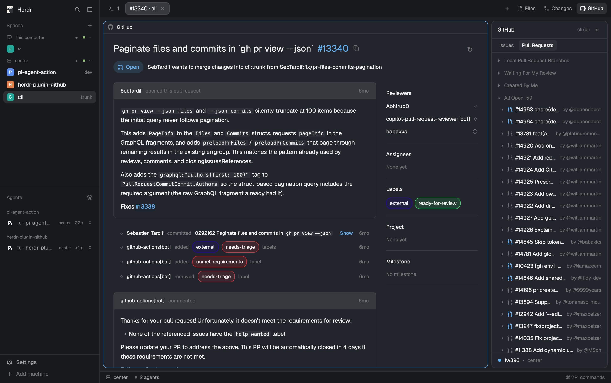

# herdr-plugin-github

[](https://github.com/lw396/herdr-plugin-github/actions/workflows/verify.yml)
[](LICENSE)

A GitHub mod for [Herdr](https://herdr.dev): browse, read and review the Issues and Pull Requests of
the repository you are working in, right beside your terminals. The interface follows the
[VS Code GitHub Pull Requests extension](https://marketplace.visualstudio.com/items?itemName=GitHub.vscode-pull-request-github).

All GitHub access goes through the GitHub CLI (`gh`) on the machine that hosts the folder, so local
and remote folders each use their own account and credentials.



## Features

**Sidebar**

- Detects the GitHub repository from the focused folder's git remotes.
- **Issues**: assigned to me, open and closed, with pagination.
- **Pull Requests**: Local Pull Request Branches, Waiting For My Review, Created By Me and All Open.
  Local branches are matched to their PRs, including merged and closed ones, without fork-name collisions.
- Hover previews with state, author, description excerpt and labels.
- Expand a PR to browse its changed files as a tree or a flat list.
- Refreshes automatically while visible, using ETags so unchanged lists cost no rate limit.

**Issue and PR tabs**

- Each issue or PR opens in its own native Herdr tab.
- Markdown descriptions and comments with reactions, labels, assignees, Projects and milestones.
- A chronological activity timeline: label and assignment changes, commits, force-pushes, reviews and
  their inline discussions.
- Links to issues and PRs in the same repository open in place, with **←** to go back.
- Comment, close, reopen, and mark draft PRs ready for review.
- Checks and commit statuses, mergeability, and merging with any method the repository allows.

**Code review**

- Unified diffs with old/new line numbers, rendered efficiently for large files.
- Existing review conversations under their diff lines, with reply and resolve/unresolve.
- Single inline comments, or **Start Review** for a pending review submitted as Comment, Approve or
  Request Changes. Pending reviews started in the browser are resumed.
- Mark files as viewed, synced with GitHub, and hide viewed files.

Unsent text survives refreshes and failed writes, and changes made in one view update the others.

## Requirements

- The [Herdr](https://herdr.dev) desktop app. Developed and tested against Herdr 0.1.13.
- A folder cloned from a GitHub repository.
- On the machine hosting that folder: `git`, and a recent GitHub CLI (`gh`, with `gh api --slurp`)
  signed in with `gh auth login`.

For remote folders, install and sign in to `gh` on the remote machine. The mod never falls back to
your local account.

## Installation

The layout is listed at [herdr.dev/layouts](https://herdr.dev/layouts): ask the agent in Herdr to add
it, or copy these into your Herdr app home yourself:

| From this repository         | To                                        |
| ---------------------------- | ----------------------------------------- |
| `github/mods/github/`        | `~/.config/herdr-app/mods/github/`        |
| `github/mods/tabs-github/`   | `~/.config/herdr-app/mods/tabs-github/`   |
| `github/layouts/github.json` | `~/.config/herdr-app/layouts/github.json` |

Then switch to the included layout:

```sh
herdr-app do layout.switch '{"name":"github"}'
```

The layout adds a **GitHub** button beside Files and Changes in the tab bar. Focus a terminal in your
repository and open it.

## Limitations

- Creating or editing issues and pull requests is not supported yet; use the browser or `gh`.
- Images are shown as links rather than loaded inline.
- Open issue and PR tabs are not restored after restarting Herdr; reopen them from the sidebar.
- Linked Projects need the corresponding GitHub token scope. Without it, Projects show `None yet`
  and the tooltip explains why.

## Development

The source lives in `src/github/`. `github/mods/github/` is the bundled output and is committed, so
installing needs neither Node.js nor npm packages. [`github/`](github/) is the folder shared at
herdr.dev, with its [`RECIPE.md`](github/RECIPE.md).

```sh
bun install
bun run dev      # rebuild on source changes
bun run verify   # lint, build, typecheck, tests and Herdr loading checks
```

`verify` needs `herdr-app` on your `PATH`. Loading checks do not lay out the UI, so check visual
changes in the app as well.

## License

[Apache-2.0](LICENSE). Some files come from the Herdr app under the same license; see [NOTICE](NOTICE).
