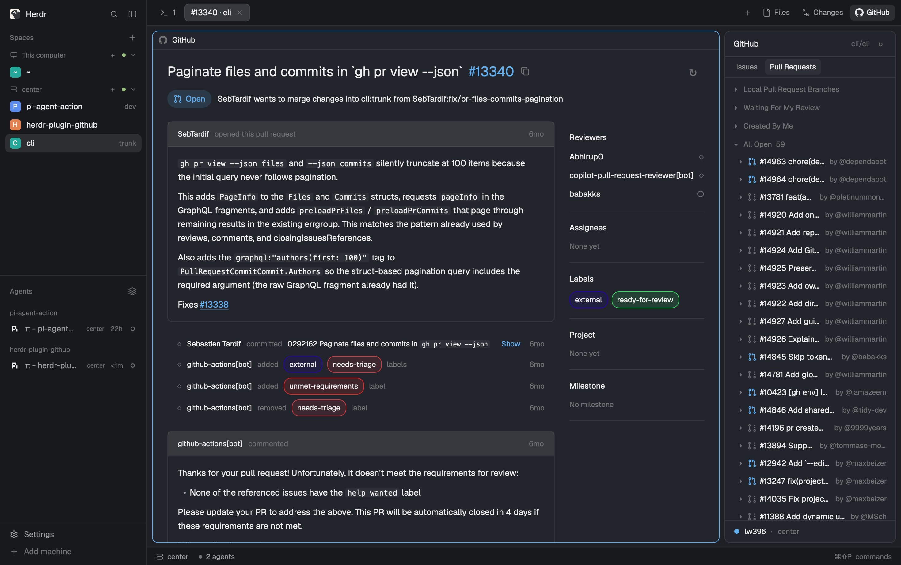

# GitHub

Herdr's main window with GitHub in it. A **GitHub** button beside Files and Changes opens a side panel
with the Issues and Pull Requests of the repository you are working in, grouped like the VS Code GitHub
Pull Requests extension. Clicking one opens it in its own Herdr tab, where you read the discussion,
comment, review diffs, and close, reopen or merge. Everything goes through `gh` on the machine that
hosts the focused folder.

## What you see

Left to right, as Herdr's `main` layout, with three changes: the GitHub button, the GitHub panel and
GitHub-aware pane headers. All colors are the theme's.

- **Sidebar**, 268px, chrome background: the brand row (46px), Spaces and Agents sharing the height,
  and the Settings / Add machine footer (69px). Unchanged from `main`.
- **Tab bar**, 42px: tabs as pills, then on the right **+**, **Files**, **Changes** and **GitHub**
  (GitHub mark, 12px text, 26px tall, 6px corners; the selected panel's button has the `selected`
  background).
- **Panes**, 8px padding and gaps, cards with 10px corners, 1px `border` (focused: `accent`). Each has
  a 30px header: the program's 14px icon, its name (medium, at most 260px), the folder with `~` for
  home (dim, truncated), and the agent's status. A GitHub tab's pane says **GitHub** with the GitHub mark.
- **Side panel**, 368px (280–900), hidden until a panel button is pressed: a stack of Files, Changes
  and **GitHub**.
- **Status bar**, 28px, unchanged.

**The GitHub panel**, a card with 10px corners and a border, 13px text, top to bottom:

- **Header**, 42px: **GitHub** (semibold); the current repository (`owner/repo`, 12px, dim,
  right-aligned, truncated); **↻**, which turns into a spinner while anything loads.
- **Tabs**, 34px: **Issues** and **Pull Requests**, 12px pills; the selected one has the hover
  background, the other is muted.
- **The list**, scrolling. Each group is a 26px heading (12px dim: ▾/▸, title, total, a spinner while
  loading), then its rows:
  - Issues: **Assigned** (unfolded at start), **Open**, **Closed**. A row is `#number` (dim), the title
    (truncated), then the assignees and a relative time (`3d`), both 12px dim.
  - Pull Requests: **Local Pull Request Branches**, **Waiting For My Review**, **Created By Me**,
    **All Open** (only this one unfolded at start). A row is ▸ (changed files), a 14px state icon (open
    `done`, draft `dim`, merged `ansi5`, closed `blocked`), `#number title` (drafts in italics), then
    `by @author` (12px dim, at most 110px).
  - Rows are 28px with 6px corners. 30 rows per page, then `Load more (N left)`. An empty group says
    so (`No open issues.`, `0 pull requests in this category`); a failed group shows a red dot, the
    reason and **Retry**, while the other groups stay.
- **Footer**, fixed, `surface` background, 12px: an 8px dot (`done` when gh works, `blocked` when it
  does not, a spinner while checking), the gh account, `·`, the machine (`this computer` or the
  remote's name). A second line says when checking for changes failed.

Without a GitHub remote, the tabs and list give way to a 28px GitHub mark, **No GitHub repository** and
`<folder> has no GitHub remote. Focus a terminal in a repository cloned from GitHub.`

**A reader tab** (one native tab per issue or PR, named `#13340 · cli`): the title with `#number` in
`accent` and a copy button; a state pill (Open, Draft, Merged or Closed in its color) and
`author wants to merge changes into base from head`. At 820px and wider, the timeline on the left and a
220px metadata column on the right; narrower tabs put the metadata above.

- Timeline: the description as a card (raised 12px header `author opened this pull request · 6mo`,
  rendered Markdown, reaction chips), comments as the same cards, and one-line activity rows
  (`◇ github-actions[bot] added [external] [needs-triage] labels   6mo`, chips in the label's color;
  commits as `0292162 subject` with **Show** for the rest of the message). Reviews are cards with
  their inline conversations, a colored diff snippet, replies and Resolve.
- Metadata: Reviewers with their review state, Assignees, Labels as colored chips, Project,
  Milestone; `None yet` when empty.
- A PR ends with a status card (a checks summary that expands to each check, mergeability, **Merge
  Pull Request** with the allowed methods) and Comment, Close, Reopen and Ready for Review. An issue
  ends with a comment box and Close/Reopen.
- A PR's diff replaces the timeline in the same tab: old/new line numbers, green additions, red
  deletions, existing conversations under their lines, and **Description** to go back.

## How it behaves

- **Agent statuses**, in pane headers: working shows a 12px spinning `working` circle; blocked a
  **Needs you** pill (10.5px semibold `blocked` on a 15% `blocked` background); done a 7px `done` dot;
  idle nothing. Hovering a header shows split right, split down, zoom and close; clicking it focuses
  the pane.
- **Panel buttons**: GitHub, Files and Changes select their panel and show it; pressing the selected
  one hides the panel. Each space remembers its own panel. GitHub is always offered, even if the
  welcome's panel choice listed only Files and Changes.
- **Which repository**: the focused terminal's folder; its git remotes are read on that folder's
  machine, preferring `upstream`, then `github`, then `origin`, then the first. Focusing a mod pane
  keeps the previous folder.
- **Click** a row to open or reselect its reader tab. **Hover** a row: its idle cells give way to **#**
  (copy `#number`) and **↗** (open in the browser); after 0.5s a 480px hover card shows repository,
  date, state, title, author, a description excerpt and labels, fetched on demand and cached for a
  minute. While the list scrolls no card opens, and an open one closes.
- **▸** on a PR row unfolds its changed files as a tree or a flat list; a file shows its diff in the
  PR's tab. Files can be marked viewed, and viewed files hidden.
- **Refresh**: while the panel is shown, the list checks for changes every 60s with ETags and reloads
  only the unfolded groups that changed; showing it again checks at once. A shown reader checks every
  10s. Hidden views never poll.
- **Links** to the same repository's issues and PRs (and `#123`) open in the same reader tab, with
  **←** to go back; other links open in the browser. Images appear as `🖼 Image` links.
- **Writes** (comment, close, reopen, ready for review, merge, reply, resolve, inline comments, pending
  reviews and their submission) update the tab at once and tell the other views; a failed write keeps
  the unsent text and shows the error.

## Built from

- `layouts/github.json`: Herdr 0.1.13's `main` layout with the tab bar block's mod set to
  `tabs-github`, the pane header set to `{"mod": "github", "props": {"role": "pane"}}` (30px, top,
  always shown), and a third child of the `panel-body` stack: block `github` with
  `{"mod": "github", "props": {"role": "panel"}}`. Shipped mods used as-is: `workspace-chrome`,
  `spaces`, `agents`, `files`, `changes`, `workspace-status`.
- `mods/tabs-github/`: a copy of Herdr's `tabs` mod with two changes marked `herdr-plugin-github`:
  `"github"` added to the enabled panels, and `panelButton("github", "GitHub",
  "mods/github/assets/github.svg")` after Changes.
- `mods/github/`: one bundled `main.js` (imports only `herdr`, `gpui-kit`, `gpui-base`) and `assets/`
  (GitHub mark, PR state icons, copy, spinner), referenced as `mods/github/assets/<file>`. A `View`
  picks a role from `props().role`: `panel`, `issue` and `pr` (readers), `pane` (the header, a copy of
  Herdr's pane header that only adds GitHub's name and mark).
- `herdr`: `focused`, `spaces`, `panes`, `props`, `exec`, `theme`, `home`, `shared`/`setShared`
  (`github.readers` for reader tabs, a short write-notice log), `nextCommand`, and `run` for
  `tab.select`, `tab.rename`, `pane.focus`, `pane.split`, `pane.zoom`, `pane.close`.
- Reader tabs come from `exec("herdr-app", ["do", "tab.new", {space, name, mod: "github",
  props: {role, reader}}])`; the panel then hands the reader its issue or PR with
  `run("github.detail:{…}")`, which the reader receives from `nextCommand()`.
- Programs, run on the focused folder's machine (`exec` with `on`): `git` (`remote -v`,
  `for-each-ref`) and `gh` (`api user --jq .login` for the account; `api` REST and GraphQL, with
  `--include` for ETags and `--paginate --slurp` for pages). Markdown is parsed with
  `mdast-util-from-markdown` and HTML with `htmlparser2`, both bundled.
- gpui-base `HoverCard`, `TextView.markdown`, `Textarea`, `Button`.

## Watch out

- Every GitHub call goes through `gh` with an explicit `owner/repo`, on the folder's machine. A remote
  folder uses the remote's gh and account, never the local one; a missing `gh` there is an error, not
  a fallback.
- `exec` has no shell, a 30s limit and an 8MiB output limit; `--slurp` needs a recent gh.
- `fetch` cannot see response headers, so ETag polling uses `gh api --include`.
- Reader contents are session-only: after a restart or hot reload, empty reader tabs close after a
  short wait. Opening the item again reuses its tab.
- The pane header role replaces Herdr's own: keep terminal headers and controls as they were.
- `tabs-github` and the layout follow Herdr 0.1.13; on an upgrade, recopy the shipped `tabs` mod and
  `main` layout and reapply the changes above.
- The 480px hover card covers the 368px panel: without the scroll handling it swallows the wheel.
- Not done: creating or editing issues and PRs, loading images inline, diff syntax highlighting.

## Done when

- `herdr-app check mods/github` and `herdr-app check mods/tabs-github` pass.
- `layout.switch {"name": "github"}` shows the window above, with GitHub after Changes in the tab bar.
- With a terminal focused in a clone of `cli/cli`, GitHub opens the panel with `cli/cli` in its header,
  your gh account in its footer and the Issues tab's **Assigned** group; GitHub again hides it.
- **Pull Requests** → **All Open** lists open PRs with state icons and `by @author`; **Load more** adds
  the next 30.
- Hovering a row shows # and ↗, then a preview card; scrolling the list closes it.
- Clicking a PR opens a `#number · cli` tab whose pane header says GitHub, with description, timeline,
  metadata and checks; clicking it again reselects that tab.
- ▸ on a PR lists changed files; a file shows its diff in that tab, and **Description** returns.
- A terminal running an agent shows its status in the pane header.
- Focusing a terminal in a folder without a GitHub remote shows **No GitHub repository**.
